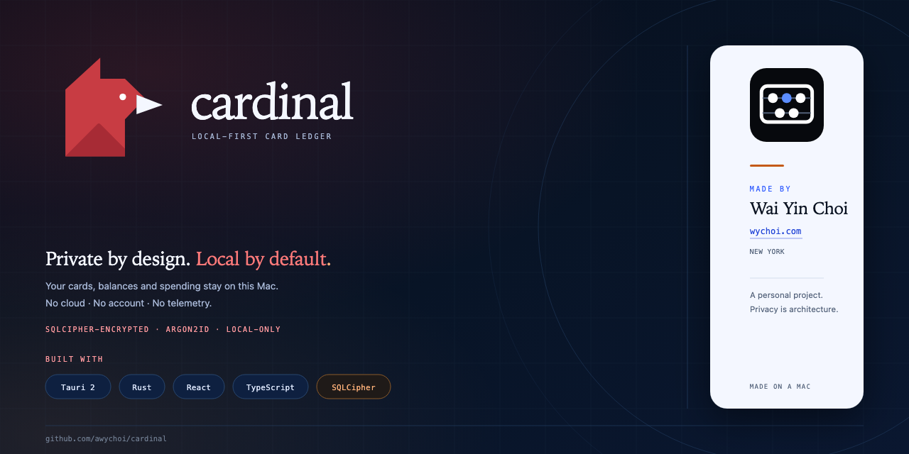
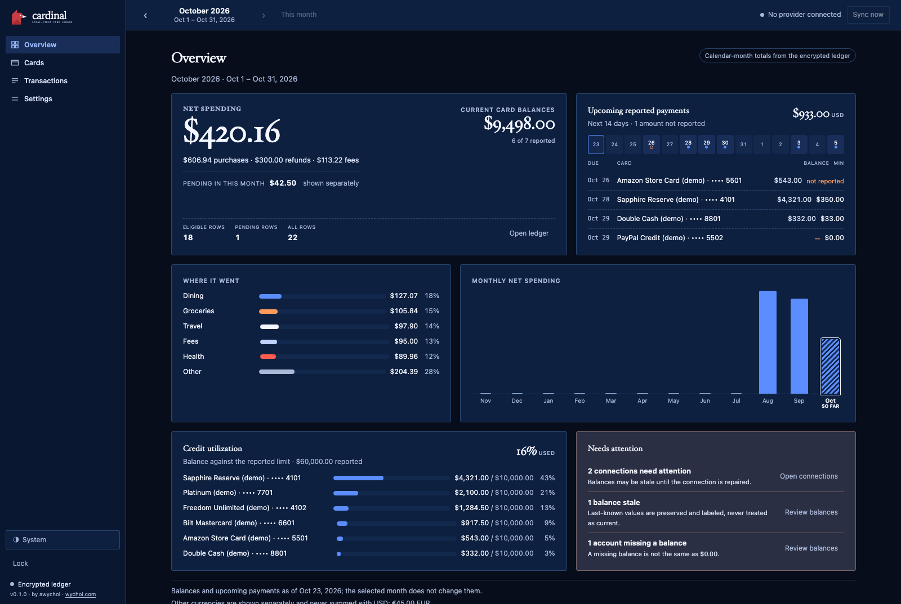

# Cardinal

A local-first, encrypted personal finance app for macOS. It tracks one person's credit-card
balances and calendar-month spending, and keeps everything on the Mac — no account, no cloud,
no telemetry.

Built with Tauri 2, React, TypeScript, Rust, and SQLCipher.



## What it does

- Calendar-month spending, kept separate from statement cycles.
- Card balances and upcoming payments that stay current regardless of the month you're viewing.
- Pending, posted, refunds, fees, payments, and transfers are distinct states.
- An encrypted ledger, unlocked with a passphrase typed into a native macOS sheet.
- Works offline with demo data or CSV import; optional Plaid **Sandbox** or **Trial/Production** connection for sync.
- One active Plaid Item per institution. A duplicate link is refused before Plaid is asked for an access token, and **Update**/**Reconnect** reuses the existing Item, so accidents cannot spend Trial Item capacity.

## Requirements

- macOS 13 or newer (developed and tested on Apple Silicon)
- Xcode Command Line Tools: `xcode-select --install`
- Rust stable via [rustup](https://rustup.rs)
- Node.js 22.12+ and pnpm 12 (`corepack enable` or `npm install -g pnpm`)
- Nothing else: SQLCipher is compiled in from the vendored crate

## Run it

```bash
git clone https://github.com/awychoi/cardinal.git
cd cardinal
pnpm install --frozen-lockfile
pnpm tauri dev
```

The first Rust build takes a few minutes; later launches are fast. The app opens locked: create a
vault with a passphrase, or choose **Open demo (synthetic data)** to look around without one.

## Build a macOS app

```bash
pnpm tauri:build
open src-tauri/target/release/bundle/macos/Cardinal.app
```

The display name and bundle are Cardinal. The bundle identifier remains
`com.awychoi.cardiganmoney`, and the Keychain service and backup seal keep their legacy values, so
existing vaults, backups and Keychain grants keep working.

The build is ad-hoc signed for local use only — not notarized, not App Sandboxed, not a
distributable release. macOS will ask once per Keychain item after each rebuild; every Plaid secret
lives in a single item, so that is one approval. If macOS complains about the signature, re-sign it
ad hoc:

```bash
codesign --force --deep --sign - src-tauri/target/release/bundle/macos/Cardinal.app
```

## Tests

```bash
pnpm verify          # typecheck, lint, unit tests, production build
pnpm test:e2e        # Playwright; run `pnpm exec playwright install chromium` first
cd src-tauri && cargo test
```

## Security notes

- **There is no passphrase recovery.** Lose the passphrase and every backup passphrase, and the
  data is unrecoverable.
- The ledger is encrypted at rest with SQLCipher; backups are encrypted containers. Plaintext CSV
  exports are not protected — the app warns before writing one.
- Plaid supports **Sandbox** test Items and **Trial/Production** real Items with separate
  credentials. The app allows one active Item per institution: if a bank is already connected, link
  completion stops before the access-token exchange and points to **Update**/**Reconnect** instead,
  so a duplicate cannot consume another Trial Item. Both environments are verified end to end:
  Sandbox on 2026-10-24 and Trial/Production on 2026-11-01 with a real Chase Item (4 credit
  accounts). Live reconnect/update mode has not been exercised against a real Item, and Trial limits
  and billing apply. The app is not affiliated with Plaid.
- The UI never receives the passphrase or provider tokens; those stay in Rust and the macOS
  Keychain.
- Read [SECURITY.md](SECURITY.md) before relying on this for real data.

## User guides

- [Documentation map](docs/README.md)
- [Plaid setup and linking](docs/integrations/plaid-guide.md)
- [Backup and recovery](docs/operations/backup-recovery.md)
- [Security architecture](docs/security/architecture.md) · [threat model](docs/security/threat-model.md) · [incident runbook](docs/security/incident-runbook.md)

## Status

Early and experimental. Interfaces, storage formats, and behavior can change. Plaid linking is
verified in both Sandbox and Trial/Production — the production path with a real Chase Item
(4 credit accounts, 2026-11-01). Live reconnect/update mode remains unverified. The macOS build is
ad-hoc signed and not distribution-ready.

## License

Copyright 2026 awychoi.

Licensed under the [Apache License, Version 2.0](LICENSE). You may use, copy, modify, merge,
publish, distribute, sublicense, and/or sell copies, including commercially, provided you give
recipients a copy of the license, mark modified files, and retain the copyright, patent,
trademark, and attribution notices that apply. The license includes an express patent grant and
does not grant permission to use the project's trademarks.

The software is provided **as is, without warranties or conditions of any kind**, express or
implied, and you use it **at your own risk**. Keep your own backups; the author is not liable for
lost data, forgotten passphrases, or incorrect financial figures.

## About this project

This is a fun experimental agentic AI workflow project, made by
[Wai Yin Choi](https://wychoi.com). It will keep being worked on and experimented with — expect
rough edges, changing directions, and new ideas over time.
