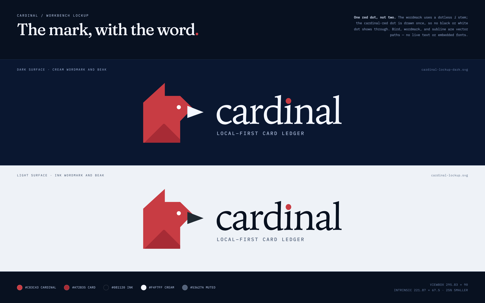

# Cardinal brand: the workbench lockup

The website workbench entry uses a horizontal lockup: the geometric cardinal mark, the
lowercase serif **cardinal** wordmark, and the subline **Local-first Card Ledger**.

## Files

| File                                                                                              | Use                                                 |
| ------------------------------------------------------------------------------------------------- | --------------------------------------------------- |
| [`src/assets/brand/cardinal-lockup-dark.svg`](../../../src/assets/brand/cardinal-lockup-dark.svg) | Dark surfaces: cream wordmark, cream beak           |
| [`src/assets/brand/cardinal-lockup.svg`](../../../src/assets/brand/cardinal-lockup.svg)           | Light surfaces: ink wordmark, ink beak              |
| [`cardinal-lockup-board.png`](cardinal-lockup-board.png)                                          | Reference board: surfaces, palette, sizes           |
| [`app-arcade-overview-dark.png`](../app-arcade-overview-dark.png)                                 | Workbench banner: Arcade theme, synthetic demo data |

Both SVGs share the same `295.83 × 90` viewBox, but their intrinsic size is **`221.87 × 67.5`** —
75% of the drawing. The workbench card only sets `max-height: 90px` and otherwise uses the intrinsic
size, so the site displays the lockup 25% smaller than the 90-unit artwork. The subline is supporting
texture at this size; if the panel is narrower, `max-width` scales it down further.

## One red i-dot

The approved comp put a red dot over the typeset `i`, leaving the letter's black or white dot
showing above it. The lockup draws a **dotless i stem** and then **one cardinal-red ellipse** at
the same size and position as the comp's red dot. There is exactly one dot at every size.

The dot is 18.8% of the wordmark height, placed 10.5% below the wordmark's ink top. It sits low
over the stem by design, not centered in the ascender space.

## Construction

- **Mark.** The supplied cardinal vector, unchanged. The only surface-dependent swap is the beak:
  `#202A32` on light, `#F4F7FF` on dark. The eye stays white and the card corner stays `#A72B35`.
- **Wordmark.** Final vector outlines (no live text, no embedded font). The setting is the approved
  comp's lowercase Iowan Old Style, tightened 3%. The ordinary `i` dot is removed; the red dot above
  is the replacement.
- **Subline.** IBM Plex Mono Medium, uppercase and tracked, converted to outlines. This matches the
  site's label voice and keeps the file self-contained.

The wordmark and subline are outlines taken from the approved comp's type setting. No font files
are shipped with the app or the site, so the lockup renders identically everywhere; keep the
project's font-licensing note in mind if the identity is used outside this project.

## Colour

| Token       | Value                 | Use                                    |
| ----------- | --------------------- | -------------------------------------- |
| Cardinal    | `#C83C43`             | Bird body and the i-dot                |
| Card corner | `#A72B35`             | The rotated card clipped into the body |
| Beak        | `#202A32` / `#F4F7FF` | Light / dark surface                   |
| Eye         | `#FFFFFF`             | Inside the head                        |
| Ink         | `#081120`             | Light-surface wordmark                 |
| Cream       | `#F4F7FF`             | Dark-surface wordmark and beak         |
| Muted       | `#53627A` / `#A9B9D8` | Light / dark subline                   |

## Usage

- Keep the bird, wordmark, and subline together. Do not set the wordmark as live text beside the
  bird, separate the elements, or add a rounded-square tile behind the bird for this lockup.
- Do not recolour the mark or the dot, add a second dot, add effects, or place the lockup on busy
  imagery. Use the dark or light file for the surface rather than inverting it.
- Leave clear space of at least the bird's beak width on every side.

## Workbench banner

[`app-arcade-overview-dark.png`](../app-arcade-overview-dark.png) is a 1600 × 1074 capture of the
October 2026 overview in the **Arcade** theme, dark mode, using the synthetic demo ledger. It shows
no real vault, provider, or account. To regenerate it, run `VITE_MOCK_BRIDGE=1 pnpm dev`, open `/?mockVault=empty` and create a
mock vault at a 1600 × 1074 viewport, switch the theme to Arcade, hide the browser-only mock-bridge
banner, and capture the overview.

## In the app

The desktop app keeps its compact live-text lockup in `BrandLogo`; the wordmark there stays
selectable and is set in Iowan Old Style. These files are for the website workbench entry and
documentation.
